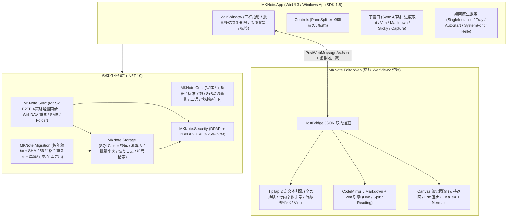

# MKNote Next 技术架构与开发规范文档

> **版本**：v1.0.0  
> **技术栈**：C# 14 / .NET 10 + WinUI 3 (Windows App SDK 1.8) + SQLCipher (AES-256) + WebView2 (TipTap 2 + CodeMirror 6 + KaTeX + Mermaid)  
> **产品定位**：100% 本地离线优先、全库加密落盘、双文档内核（富文本 + Markdown）、支持灵活三栏拖动布局、深浅双态特色背景、事务级批量管理、严格判重导入与精准导出、多策略 E2EE 群晖 NAS / WebDAV 同步的现代 Windows 桌面知识库。

---

## 目录

1. [系统架构总览](#1-系统架构总览)
2. [模块分层与职责边界](#2-模块分层与职责边界)
3. [本地加密存储与数据模型](#3-本地加密存储与数据模型)
4. [双内核编辑器、全宽排版与深浅背景协议](#4-双内核编辑器全宽排版与深浅背景协议)
5. [端到端加密多策略同步与删除墓碑设计](#5-端到端加密多策略同步与删除墓碑设计)
6. [智能编码去重导入与精准多级导出设计](#6-智能编码去重导入与精准多级导出设计)
7. [安全性、防崩溃与桌面原生集成](#7-安全性防崩溃与桌面原生集成)
8. [国际化、灵活三栏布局与系统字体保护](#8-国际化灵活三栏布局与系统字体保护)
9. [构建、测试与打包发布规范](#9-构建测试与打包发布规范)

---

## 1. 系统架构总览

MKNote Next 采用 **原生 WinUI 3 桌面外壳 + 分层 .NET 10 核心类库 + 离线本地 WebView2 双内核编辑器** 的混合架构：



---

## 2. 模块分层与职责边界

| 项目 | 目标框架 | 职责边界 |
| :--- | :--- | :--- |
| `MKNote.Core` | `net10.0` | 领域实体模型（`NoteItem`、`CategoryItem`、`AppSettings`、`SyncSettings` 等）、8 套浅色 + 8 套深色 `BackgroundPreset`、仓储接口 `IVaultRepository`、Markdown 分析与中英日字数统计 `MarkdownAnalyzer`、内置模板 `BuiltinTemplates`、三语词条 `Strings`、快捷键目录与保留热键守卫 `ShortcutGuard` |
| `MKNote.Security` | `net10.0` | `VaultKeyManager`（256 位主密钥生成、DPAPI / 便携密钥封装、逐 BLOB AES-256-GCM 加密）；`NoteCryptoService`（PBKDF2-SHA256 + AES-256-GCM 单篇笔记加密、应用锁口令哈希与常量时间校验） |
| `MKNote.Storage` | `net10.0` | `SqliteVaultRepository`（基于 `SQLitePCLRaw.bundle_e_sqlcipher` 的整库加密仓储）、分类/标签/笔记/附件/双链/全局资源 CRUD、同步删除墓碑表 `sync_tombstones`、单事务批量删除/恢复、并行全库精准符号检索、防崩溃加密恢复日志、本地历史版本库 `revisions.db` 与 `.mkbackup` 备份 |
| `MKNote.Sync` | `net10.0` | `EncryptedSyncService`（MKS2 分层会话密钥 E2EE、增量索引清单 `manifest.mke`、删除墓碑 `tombstones.mke`、4 种同步/备份策略、4 路并发与实时进度回调）、`WebDavSyncTransport`（多级 `MKCOL`、重定向保认证、`429/502/503/504` 退避重试、写探针与 `DELETE`）、`FolderSyncTransport`、`SyncGuideProvider` |
| `MKNote.Migration` | `net10.0` | `MknotePackageReader`（`.SFDS`/MKEN/ZLIB 解析器、32KB NUL 奇偶特征 + 可读性评分智能编码识别）、`VaultMigrationService`（全通道 SHA-256 严格判重导入、单篇 `.md`/单文件自包含 `.html` 导出、指定分类多级目录导出、多选批量与全库导出） |
| `MKNote.EditorWeb` | Vite 6 + TS | 纯离线打包输出至 `src/MKNote.App/Assets/EditorWeb`，不依赖任何外网 CDN；封装富文本、Markdown、全宽文档排版、深浅主题背景与纹理、系统字体/字号工具条、待办复选框转换器、Vim 状态条、KaTeX、Mermaid、知识图谱与字数统计 |
| `MKNote.App` | `net10.0-windows10.0.19041.0` | WinUI 3 主程序、`PaneSplitter` 拖动分隔条、WebView2 虚拟域加密媒体拦截、导出与判重结果弹窗、同步策略与实时进度取消窗口、区域截图、系统托盘、开机自启、安全系统字体服务与严格单实例守护 |
| `MKNote.Tests` | `net10.0` | 16 项完全自包含 xUnit 单元测试，覆盖加密安全、仓储 CRUD、批量事务、符号检索、防崩溃恢复、MKS2 增量同步与 4 策略墓碑删除、智能编码检测、严格判重导入与单篇/分类/批量导出 |

---

## 3. 本地加密存储与数据模型

### 3.1 零明文磁盘策略
- **数据库级加密**：`vault.db` 与 `revisions.db` 均通过 SQLCipher 以 256 位十六进制主密钥打开，文件头部不包含 `SQLite format 3` 明文魔数。
- **对象级二次加密**：`notes.content_blob` 与 `media_blobs.cipher_blob` 均经 `VaultKeyManager.EncryptBlob` 按 `[4B "MKB1"][12B Nonce][16B AuthTag][Ciphertext]` 执行 AES-256-GCM 认证加密（AAD 绑定 `"MKB1"`）。
- **主密钥保护（`vault.key`）**：
  - 标准模式：`MKVK` 魔数头 + Windows `ProtectedData.Protect(..., DataProtectionScope.CurrentUser)`。
  - 便携模式（程序同级存在 `Data/` 目录或 `portable.flag` 时自动激活）：`MKVP` 魔数头 + 便携信封密钥封装。
- **附件去重与垃圾回收**：截图、插入图片与导入媒体按内容 `SHA-256` 去重存入 `media_blobs`；全局文档背景图登记于 `global_assets` 表，免受普通笔记附件垃圾回收误删。

### 3.2 核心数据表与批量事务能力（`SchemaSql.cs` / `SqliteVaultRepository.cs`）
- `categories`：多级笔记本目录树，支持默认与自定义目录自由删除（初始化标记写入 `settings`，删除默认目录后重启不重建）。
- `notes`：笔记元数据、加密正文 `content_blob`、`content_sha256`、摘要、格式标记、背景配置、置顶/星标/加密/便签/软删除标记。
- `tags` & `note_tags`：多对多标签关联，富文本与 Markdown 统一支持。
- `media_blobs` & `attachments` & `global_assets`：加密媒体内容池与引用表。
- `note_links`：Markdown 双向链接与嵌入关系表，驱动反向链接与知识图谱。
- `sync_tombstones`：同步删除墓碑表（`entity_type, entity_id, deleted_at`），仅记录彻底删除的笔记 ID 与时间戳、不存任何明文正文，驱动跨设备真删除与 90 天过期清理。
- `notes_fts`：SQLite FTS5 trigram 虚拟表，结合全库解密内存缓存并行扫描支持 `C#`、`->`、`[[双链]]`、`$100` 等任意符号精准检索。
- **事务级批处理 API**：`SoftDeleteNotesBatchAsync`、`RestoreNotesBatchAsync`、`PermanentlyDeleteNotesBatchAsync`（同事务写入删除墓碑并统一执行一次孤立媒体垃圾回收）。

---

## 4. 双内核编辑器、全宽排版与深浅背景协议

### 4.1 离线虚拟主机与媒体安全拦截
- WebView2 将 `https://appassets.mknote.local/` 映射到程序本地离线目录 `Assets/EditorWeb/`。
- 所有图片与附件统一使用受控虚拟地址 `https://vault.mknote.local/attachments/{sha256}`。
- `MainWindow.OnWebResourceRequested` 拦截请求，实时在内存中解密对应 `SHA-256` 密文流返回给 WebView2，同时屏蔽外部非本地域 HTTP/HTTPS 请求，保障 100% 离线安全。

### 4.2 全宽排版与 8+8 深浅特色背景
- **全宽文档画布（`theme.css`）**：富文本（`#rich-editor`）、Markdown 源码（`.cm-content`）与阅读视图（`.markdown-body`）统一采用 `width: 100%; max-width: none; padding: 20px 24px`（与顶部 `NoteHeaderBar` 左边距 `24px` 精确对齐）。
- **深浅双态特色背景（`DocumentFormat.cs` + `main.ts` + `theme.css`）**：
  - `BackgroundPreset.All` 为每个预设 ID 同时维护 `LightHex / LightName` 与 `DarkHex / DarkName`（浅色 8 套 + 深色 8 套），每套均满足 WCAG 文字对比度。
  - `body.theme-dark` 不硬编码覆盖 `--doc-bg`，由 `main.ts` 的 `applyBackground` 将当前主题色直接同步到 `documentElement` 与 `document.body`，确保深色模式下切换 8 套特色暗夜背景与 5 种纸张纹理实时生效。

### 4.3 JSON 消息协议（`HostBridge`）
- **宿主 → 编辑器**：`editor.loadDocument`、`editor.clear`、`editor.setLocale`、`editor.setSystemFonts`、`editor.setBackground`、`editor.setBackgroundImage`、`editor.setVimConfig`、`editor.setMarkdownShortcuts`、`editor.setViewMode`、`editor.execCommand`、`editor.insertMedia`、`editor.scrollToHeading`、`editor.updateKnownTitles`、`graph.loadData`。
- **编辑器 → 宿主**：`editor.ready`、`editor.fontSettingsChanged`、`doc.contentChanged`、`doc.statsChanged`、`doc.forceSaveRequested`、`doc.openWikiLink`、`doc.savePastedAsset`、`doc.pickImageRequested`、`doc.captureScreenRequested`、`vim.modeChanged`、`graph.openNote`、`graph.close`。

---

## 5. 端到端加密多策略同步与删除墓碑设计

### 5.1 远端目录结构
```text
<SyncRoot>/
├── meta/
│   ├── kdf.json           # 公开随机盐与 KDF 参数（PBKDF2-SHA512 / 210,000 迭代，不含密钥）
│   ├── categories.mke     # 笔记本分类列表（MKS2 E2EE 密文）
│   ├── manifest.mke       # 增量同步索引清单（记录每篇笔记 UpdatedAt / ContentSha256 / 元数据，MKS2 密文）
│   └── tombstones.mke     # 加密删除墓碑清单（保留 90 天内彻底删除的笔记 ID 与时间戳，MKS2 密文）
├── notes/{noteId}.mke     # 单篇笔记密文快照（AES-256-GCM）
└── blobs/{sha256}.mkb     # 按内容去重的加密图片与附件数据块（AES-256-GCM）
```

### 5.2 `MKS2` 分层会话加密架构（百倍提速 + 向下兼容 `MKSE` v1）
- 每次同步仅执行 **1 次** `PBKDF2-SHA512(passphrase, kdf.salt, 210_000, 32)` 派生 256 位会话主密钥 `sessionMasterKey`（结束于 `finally` 清零内存）。
- 每个文件独立生成 16B 随机 `fileSalt` 与 12B 随机 `nonce`，通过 `HKDF-SHA256(sessionMasterKey, fileSalt, "MKNoteSync-E2EE-v2")` 在微秒级派生专属 256 位 AES-GCM 密钥，封包格式 `[4B "MKS2"][16B fileSalt][12B nonce][16B tag][ciphertext]`。
- `UnwrapPayload` 同时兼容解密旧版 `MKSE` v1（每文件独立 PBKDF2）与 `MKSP` 非 E2EE 封包，实现无缝升级。

### 5.3 四种同步与备份策略
1. **`Bidirectional`（默认）**：双向增量合并 + 冲突自动保留副本 + 合并 `sync_tombstones` 与 `meta/tombstones.mke`；若 `deletedAt >= note.UpdatedAt` 则调用 `DeleteFileAsync` 清理远端并联动删除其他设备本地旧笔记，彻底杜绝删除复活；若另一设备在删除时间之后再次编辑过则保留较新改动防误删。
2. **`MergeKeepBoth`**：双端保守合并 + 冲突副本保护，忽略墓碑、不因本地删除而清理远端文件。
3. **`LocalMaster`**：单向镜像备份（本地 → 远端），覆盖远端分类/笔记、上传本地图片，并自动清理远端存在但本机已不存在的多余/残留文件（受本地所有笔记含加密笔记保护，不误删加密笔记）。
4. **`RemoteMaster`**：单向云端恢复（远端 → 本地），拉取远端笔记/分类/图片覆盖本机同名版本并应用远端删除墓碑，绝不向远端写入或删除任何数据。

### 5.4 WebDAV 传输层健壮性（`WebDavSyncTransport`）
- 使用 `SocketsHttpHandler`（连接池 8 并发、关闭 `Expect: 100-continue`、120s 超时）并在后台线程池 `Task.Run` 执行，绝不阻塞 WinUI 界面线程；
- 多级远端路径按段逐级 `MKCOL` 创建，避免 `409 Conflict`；
- 手动跟随 `301/302/307/308` 重定向以保留 `Basic` 认证头；
- 遇到 `429/502/503/504` 或网络瞬断自动指数退避重试 3 次；
- `TestConnectionAsync` 执行 `PROPFIND` + 临时文件写入/删除探针，提前发现只读权限问题；
- `SyncWindow` 底部固定实时进度栏，展示当前处理项计数（如 `正在上传加密笔记 (45 / 200)...`）与百分比，并支持随时点击「取消」或关闭窗口立即中止后台请求。

---

## 6. 智能编码去重导入与精准多级导出设计

### 6.1 智能编码识别（`MknotePackageReader`）
- `DecodeHtmlPayload` 与 `DecodeTextSmart` 按顺序执行：
  1. UTF-8 / UTF-16LE / UTF-16BE BOM 检测；
  2. 最多扫描前 **32KB** 的奇偶位 NUL 特征（`DetectUtf16ByNullParity`），精准捕获纯中文开头、后文才出现 `<br>` 或英文的无 BOM UTF-16LE 文档；
  3. 严格 UTF-8（无非法字节且无 NUL）；
  4. 无 NUL 且非 UTF-8 场景下对 UTF-16LE 与 GB18030 解码结果执行自然语言可读性评分对比（`ScoreDecodedText`），彻底解决纯中文无 BOM 文档误判乱码问题。
- 所有外部导入通道（`.mknote` / `.md` / `.html` / `note.ini`）均统一复用该智能解码器。

### 6.2 严格全一致导入判重（`VaultMigrationService`）
- 覆盖 `.mknote`、Markdown 文件夹、HTML 文件夹、本地 SQLite `.db` 全部 4 个通道。
- **写库前内存中预组装判重**：先完成待办复选框规范化（`NormalizeImportedHtmlTodos`）与全部内嵌图片/本地图片的确定性 `SHA-256` 链接重写（`https://vault.mknote.local/attachments/{sha256}`），再通过 `DuplicateIndex` 比对 `(DocFormat, Title, ContentSha256)`（并在同标题同格式时兼容 `\r\n` 与 `\n` 归一化比对）。
- 仅在 100% 确认完全一致时跳过导入，采用延迟建分类避免产生空文件夹；同批次内重复文件同步去重；发现重复时在 `MainWindow` 弹出重复文档清单提示。

### 6.3 精准多级导出架构（`VaultMigrationService`）
- **单篇导出（`ExportSingleNoteAsync`）**：
  - `DocumentFormat.Markdown` → 强制限定 `.md`，若含加密图片则同级生成 `assets/` 并重写相对路径（无图片不建多余目录）；
  - `DocumentFormat.RichHtml` → 强制限定 `.html`，封装为独立完整 HTML5 文档（含排版 CSS 与待办清单样式），内嵌图片自动转 `Data URI` 单文件自包含，离线双击即看。
- **指定分类单独导出（`ExportCategoryAsync`）**：支持 `includeSubcategories`（递归保留多级子目录树或仅导出当前层级），按每篇真实格式分别导出 `.md` 与 `.html`，还原各目录 `assets/` 图片，同名自动编号防覆盖（`标题 (2).md`）。
- **多选批量导出（`ExportNotesBatchAsync`）与全库导出（`ExportAllNotesAsync`）**：统一复用上述导出管线，自动安全跳过未解锁的独立加密笔记并在结果弹窗汇报明细及提供「打开所在位置」快捷按钮。

---

## 7. 安全性、防崩溃与桌面原生集成

- **防崩溃恢复**：`App.xaml.cs` 捕获 UI / AppDomain / Task 未处理异常写入 `%LOCALAPPDATA%\MKNoteNext\Logs\`；每次编辑先异步写入加密恢复文件 `recovery/{noteId}.mkr`，正式落盘后清除；异常重启后自动恢复所有未提交草稿。
- **严格单实例（`SingleInstanceGuard`）**：基于 `Local\MKNoteNext_StrictSingleInstance_Mutex_9F4E2A7C` 互斥量与命名管道唤醒通道，彻底禁止双开多开，重复启动自动唤起前台或托盘中已有窗口。
- **系统托盘与开机自启**：基于 Win32 `Shell_NotifyIconW` + `SetWindowSubclass` 实现零额外依赖托盘；开机自启写入当前用户注册表 `Run` 项并带 `--autostart` 静默驻留托盘。
- **纯内存区域截图（`ScreenCaptureService` + `ScreenCaptureWindow`）**：跨多显示器截取虚拟屏幕位图，高 DPI 裁剪后在内存中编码为 PNG 直接加密存入数据库。

---

## 8. 国际化、灵活三栏布局与系统字体保护

- **三语热切换（`Strings.cs`）**：完整支持 `zh-CN`、`en-US`、`ja-JP`，涵盖主界面、导出菜单、批量操作栏、知识图谱、系统托盘菜单与同步指南。
- **灵活三栏拖动布局（`PaneSplitter.cs`）**：
  - 继承自 `Grid` 的轻量分隔条控件，内置 `InputSystemCursorShape.SizeWestEast`（`↔`）光标与悬停高亮竖线，以父级容器为坐标系计算偏移消除拖拽抖动；
  - 支持左侧导航栏、中间笔记列表栏、右侧信息抽屉三栏独立拖动放缩，双击恢复默认宽度，并持久化保存至 `AppSettings`（`SidebarWidth`、`NoteListWidth`、`InspectorWidth`）。
- **系统字体与 WinUI 图标保护（`SystemFontService.cs` + `MainWindow.ApplyUiFont`）**：
  - 枚举系统字体时自动跳过 `@` 竖排字体、`SYMBOL_CHARSET` 及符号/图标类字体；
  - 界面与编辑器均自动附加中/英/日安全回退链；
  - 递归应用界面字体时严格跳过 `IconElement` 子树、内置图标字体控件及包含 Unicode 私用区图标字符（`U+E000–U+F8FF`）的元素，杜绝切换字体导致图标乱码。
- **固定快捷键守卫（`ShortcutGuard`）**：禁止自定义 Vim 或 Markdown 快捷键覆盖应用核心固定热键，同时校验重复冲突。

---

## 9. 构建、测试与打包发布规范

### 9.1 验证命令
```powershell
# 1. 前端类型检查（含未使用变量扫描）与离线构建
cd src/MKNote.EditorWeb
npx tsc --noEmit --noUnusedLocals --noUnusedParameters
npm run build
cd ../..

# 2. 单元测试（要求 16/16 全通过、0 警告）
dotnet test tests/MKNote.Tests/MKNote.Tests.csproj -c Release

# 3. 桌面应用 Release 构建 (x64，要求 0 警告 0 错误)
dotnet build src/MKNote.App/MKNote.App.csproj -c Release -p:Platform=x64
```

### 9.2 正式安装包打包与仓库规范
1. 执行 `dotnet publish src/MKNote.App/MKNote.App.csproj -c Release -r win-x64 --self-contained true -p:Platform=x64 -o dist/publish-x64`。
2. 执行 `iscc installer/MKNoteNext.iss` 生成安装包 `dist/MKNoteNext_Setup_v1.0.0_x64.exe`，随后清理中间解包目录 `dist/publish-x64`。
3. `.gitignore` 严格排除 `bin/`、`obj/`、`dist/`、`node_modules/`、`src/MKNote.App/Assets/EditorWeb/`、用户数据与测试归档及所有可执行/安装包文件，确保 Git 仓库仅包含纯净可复现的源码、测试与文档。
