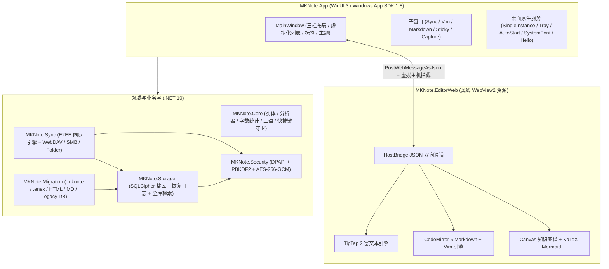

# MKNote Next 技术架构与开发规范文档

> **版本**：v1.0.0  
> **技术栈**：C# 14 / .NET 10 + WinUI 3 (Windows App SDK 1.8) + SQLCipher (AES-256) + WebView2 (TipTap 2 + CodeMirror 6 + KaTeX + Mermaid)  
> **产品定位**：100% 本地离线优先、全库加密落盘、双文档内核（富文本 + Markdown）、支持端到端加密（E2EE）群晖 NAS 与 WebDAV 同步的现代 Windows 桌面知识库。

---

## 目录

1. [系统架构总览](#1-系统架构总览)
2. [模块分层与依赖关系](#2-模块分层与依赖关系)
3. [本地加密存储与数据模型](#3-本地加密存储与数据模型)
4. [双内核编辑器与前后端桥接协议](#4-双内核编辑器与前后端桥接协议)
5. [端到端加密同步引擎设计](#5-端到端加密同步引擎设计)
6. [多格式数据导入与导出管线](#6-多格式数据导入与导出管线)
7. [安全性、防崩溃与桌面原生集成](#7-安全性防崩溃与桌面原生集成)
8. [国际化、主题外观与快捷键保护](#8-国际化主题外观与快捷键保护)
9. [构建、测试与打包发布规范](#9-构建测试与打包发布规范)

---

## 1. 系统架构总览

MKNote Next 采用 **原生 WinUI 3 桌面外壳 + 分层 .NET 10 类库 + 离线本地 WebView2 双引擎编辑器** 的混合架构：



---

## 2. 模块分层与依赖关系

| 项目 | 目标框架 | 职责边界 |
| :--- | :--- | :--- |
| `MKNote.Core` | `net10.0` | 领域实体模型（`NoteItem`、`CategoryItem`、`AppSettings`、`SyncSettings` 等）、仓储接口 `IVaultRepository`、Markdown 静态分析与 Word 风格字数统计 `MarkdownAnalyzer`、内置模板 `BuiltinTemplates`、三语词条 `Strings`、快捷键目录与固定热键保护 `ShortcutGuard` |
| `MKNote.Security` | `net10.0` | `VaultKeyManager`（256 位主密钥生成、DPAPI / 便携密钥封装、逐 BLOB AES-256-GCM 加密）；`NoteCryptoService`（PBKDF2-SHA256 + AES-256-GCM 单篇笔记与 E2EE 同步加密、应用锁口令哈希与常量时间校验） |
| `MKNote.Storage` | `net10.0` | `SqliteVaultRepository`（基于 `SQLitePCLRaw.bundle_e_sqlcipher` 的整库加密仓储）、分类/标签/笔记/附件/双链/全局资源 CRUD、并行全库精准符号检索、防崩溃加密恢复日志、本地历史版本库 `revisions.db` 与 `.mkbackup` 备份 |
| `MKNote.Sync` | `net10.0` | `EncryptedSyncService`（基于版本清单与时间戳的增量双向同步、冲突副本保护、E2EE 密文打包）、`WebDavSyncTransport`（群晖 WebDAV 与通用 WebDAV）、`FolderSyncTransport`（SMB 共享与本地目录）、`SyncGuideProvider`（三语配置向导） |
| `MKNote.Migration` | `net10.0` | `MknotePackageReader`（SFDS/MKEN/ZLIB `.mknote` 归档解析器）、`VaultMigrationService`（流式 `.enex`/`.notes` 解析与 Base64 媒体提取、HTML 文件夹图文导入、Markdown 文件夹双向导入导出、旧版 SQLite 数据库迁移） |
| `MKNote.EditorWeb` | Vite 6 + TS | 前端纯离线打包输出至 `src/MKNote.App/Assets/EditorWeb`，不依赖任何外部 CDN；封装富文本、Markdown、Vim 状态条、KaTeX、Mermaid、Canvas 图谱与 Word 字数统计 |
| `MKNote.App` | `net10.0-windows10.0.19041.0` | WinUI 3 主程序入口、窗口编排、自定义 WebView2 虚拟域请求拦截、区域截图、系统托盘、开机自启、系统字体枚举与严格单实例守护 |
| `MKNote.Tests` | `net10.0` | 自包含 xUnit 单元测试套件，覆盖加密安全、仓储 CRUD、符号检索、防崩溃恢复、E2EE 同步与多格式导入导出 |

---

## 3. 本地加密存储与数据模型

### 3.1 零明文磁盘策略
- **数据库级加密**：`vault.db` 与 `revisions.db` 均通过 SQLCipher 以 256 位十六进制主密钥打开，文件头部不包含 `SQLite format 3` 特征魔数。
- **对象级二次加密**：表 `notes.content_blob` 与 `media_blobs.cipher_blob` 均经 `VaultKeyManager.EncryptBlob` 按格式 `[4B "MKB1"][12B Nonce][16B AuthTag][Ciphertext]` 进行 AES-256-GCM 认证加密（AAD 绑定 `"MKB1"`）。
- **主密钥保护（`vault.key`）**：
  - 标准模式：`MKVK` 魔数头 + Windows `ProtectedData.Protect(..., DataProtectionScope.CurrentUser)`。
  - 便携模式（当程序同级存在 `Data/` 目录时自动激活）：`MKVP` 魔数头 + 内置便携信封密钥封装，支持 U 盘跨机携带。
- **附件去重与垃圾回收**：所有截图、插入图片与导入资源按内容 `SHA-256` 去重存入 `media_blobs`；全局文档背景图登记于 `global_assets` 表，独立于普通笔记附件垃圾回收逻辑，避免误清理。

### 3.2 核心数据表（`SchemaSql.cs`）
- `categories`：多级分类目录树，支持默认与自定义文件夹自由删除（通过 `settings` 表记录初始化标记，避免删除默认目录后重启重建）。
- `notes`：笔记元数据、加密正文 `content_blob`、摘要、格式标记（`rich_html` / `markdown`）、背景色/样式、置顶/星标/单篇加密/便签/软删除标记。
- `tags` & `note_tags`：多对多标签关联，富文本与 Markdown 统一支持。
- `media_blobs` & `attachments`：内容去重加密媒体池与笔记附件关系表。
- `note_links`：Markdown 双向链接与嵌入关系表，支撑反向链接与知识图谱。
- `notes_fts`：SQLite FTS5 trigram 虚拟表（辅助快速检索），同时结合全库解密并行扫描实现 `C#`、`->`、`[[...]]`、`$100` 等任意符号的精准匹配。
- `settings` & `global_assets`：应用配置 JSON 与全局加密资源引用。

---

## 4. 双内核编辑器与前后端桥接协议

### 4.1 离线虚拟主机与媒体安全拦截
- WebView2 将 `https://editor.mknote.local/` 映射到程序本地离线目录 `Assets/EditorWeb/`。
- 所有图片与附件引用统一使用受控虚拟 URL：`https://vault.mknote.local/attachments/{sha256}`。
- `MainWindow` 拦截 `CoreWebView2.WebResourceRequested`，实时从 `SqliteVaultRepository` 内存解密对应 `SHA-256` 密文并以正确 `Content-Type` 流式返回给 WebView2，全程零临时明文落盘。

### 4.2 JSON 消息协议（`HostBridge`）
- **宿主 → 编辑器**：`doc.load`、`doc.setMode`、`doc.insertImage`、`doc.setAppearance`、`doc.setGlobalBackground`、`editor.setVimConfig`、`editor.setMarkdownShortcuts`、`editor.execCommand`、`graph.show`。
- **编辑器 → 宿主**：`editor.ready`、`doc.changed`（含防抖正文与实时 Word 字数统计）、`doc.dirtySnapshot`（用于写入防崩溃恢复日志）、`doc.requestSave`、`doc.uploadImage`（粘贴/拖拽图片二进制 Base64 交由宿主加密入库）、`editor.openWikiLink`、`graph.openNote`。

### 4.3 工具条与编辑体验规范
- **富文本工具条**：高频操作直接平铺，扩展文本处理工具（大小写转换、去行尾空格、行排序、行去重、插日期时间等）收纳在 `>>` 展开栏；已移除冗余纯文本/源码切换按钮。
- **Markdown 工具条**：保留 **行内预览（Live Preview）** 与 **阅读模式（Reading）** 双态切换（阅读模式通过独立外层滚动容器保证长文档完整上下滚动），扩展工具（多级标题、代码块、Callout、公式、Mermaid、表格等）收纳在 `>>` 展开栏。
- **Vim 增强**：底部状态栏实时呈现 `-- NORMAL --` / `-- INSERT --` / `-- VISUAL --` 及按键序列；对富文本与 Markdown 均确保图片左右可正确落位光标并支持 `x`/`dd`/退格删除图片。

---

## 5. 端到端加密同步引擎设计

### 5.1 远端目录布局
同步目标（群晖 NAS / WebDAV / 本地目录）中仅保存如下结构，不包含明文数据库：
```text
<SyncRoot>/
├── manifest.json          # 远端同步清单（记录各笔记/附件版本与更新时间）
├── notes/{noteId}.mke     # 单篇笔记快照（E2EE 开启时为 AES-256-GCM 密文 JSON）
└── blobs/{sha256}.mkb     # 去重图片与附件数据块（E2EE 开启时为 AES-256-GCM 密文）
```

### 5.2 同步与冲突解决流程
1. **口令派生**：使用用户 E2EE 口令通过 PBKDF2-SHA256（120,000 次迭代 + 随机盐）派生独立密钥加密每个同步对象。
2. **增量合并**：
   - 本地存在而远端缺失 → 加密上传。
   - 远端存在而本地缺失 → 拉取解密并写入本地 `vault.db`（同时自动补齐缺失的分类与媒体 BLOB）。
   - 双端均存在且内容哈希不一致：
     - 若一方自上次同步后未变更，以较新版本覆盖；
     - 若双端并发修改，自动在本地保留一份标题带 `[同步冲突副本 ...]` 的完整副本后再合入远端版本，确保零正文丢失。
3. **传输容错**：`WebDavSyncTransport` 支持 Basic 认证、`MKCOL` 递归建目录、`PROPFIND` 列举及可选局域网自签名证书信任；`FolderSyncTransport` 采用 `.tmp` 写入后原子 `File.Move` 替换，防止半截损坏文件。

---

## 6. 多格式数据导入与导出管线

- **`.mknote` 归档解析（`MknotePackageReader`）**：解析 `SFDS` 容器头、目录区与 `MKEN` 数据块（自动识别 ZLIB 压缩标记），提取 `info.ini` 元数据（分类/标签/时间戳）、`content.html` 正文与 `\res\*` 图片资源，并将失效外部链接重写为 `https://vault.mknote.local/attachments/{sha256}`。
- **`.enex` / `.notes` 流式解析（`VaultMigrationService.ImportEnexArchiveAsync`）**：使用 `XmlReader` 逐条流式读取超大归档（支持数百 MB 级文件低内存导入），提取 ENML 正文、待办事项 `<en-todo>` 与 Base64 编码的 `<resource>` 图片，匹配 `<en-media hash="...">` 并全部加密入库；对于归档内受加密块保护的特殊节点提供明确统计告警。
- **HTML 文件夹批量导入**：递归扫描 `.html`/`.htm`，解析 `<title>` 与相对路径 ``，将同级资源目录中的图片自动加密写入 `media_blobs` 并重写引用。
- **Markdown 文件夹双向导入导出**：保留目录层级作为分类，支持 YAML Frontmatter 标签提取、相对路径图片入库与导出重建。

---

## 7. 安全性、防崩溃与桌面原生集成

- **防崩溃恢复机制**：
  - `App.xaml.cs` 注册 `UnhandledException`、`AppDomain.UnhandledException` 与 `TaskScheduler.UnobservedTaskException`，记录崩溃日志至 `%LOCALAPPDATA%\MKNoteNext\Logs\`。
  - 编辑脏数据实时异步写入 `recovery/{noteId}.mkr`（经 `VaultKeyManager` 加密）；正常落盘后删除对应恢复项；启动时若存在未清理的 `.mkr` 文件，自动合并恢复并提示用户。
- **严格单实例（`SingleInstanceGuard`）**：进程启动立即抢占 `Local\MKNoteNext_StrictSingleInstance_Mutex_9F4E2A7C`；若已被占用则通过命名管道发送 `WAKE` 信号唤醒既有进程（即使窗口隐藏于系统托盘）并立即退出。
- **系统托盘与开机自启**：基于 Win32 `Shell_NotifyIconW` + `SetWindowSubclass` 实现零额外依赖托盘；开机自启写入 `HKCU\Software\Microsoft\Windows\CurrentVersion\Run` 并附带 `--autostart` 参数静默最小化启动。
- **纯内存区域截图（`ScreenCaptureService` + `ScreenCaptureWindow`）**：跨多显示器截取虚拟屏幕位图，高 DPI 坐标换算裁剪并通过 `BitmapEncoder` 内存编码为 PNG 后直接加密入库。

---

## 8. 国际化、主题外观与快捷键保护

- **三语本地化（`MKNote.Core.Localization.Strings`）**：内置 `zh-CN`、`en-US`、`ja-JP` 完整词条，覆盖主界面导航、按钮提示、系统托盘菜单与同步向导，运行时可即时热切换。
- **系统字体分离配置（`SystemFontService`）**：通过 GDI `EnumFontFamiliesExW` 枚举全部已安装系统字体，支持在设置中分别指定「界面字体」与「文档编辑器字体」。
- **多层外观体系**：支持浅色 / 深色 / 跟随系统主题、Windows 11 Mica 材质、单篇文档背景色（含 WCAG 自动前景色对比度计算）与全局加密背景图（5 种平铺/填充模式）。
- **固定快捷键守卫（`ShortcutGuard`）**：严格禁止用户将 Vim 或 Markdown 自定义快捷键绑定到应用核心全局热键（如 `Ctrl+C`/`V`/`X`/`A`/`Z`/`Y`/`S`/`F`/`K`/`E`、`Ctrl+Shift+A`、`Esc`、`F1-F12` 等），并在保存前检测重复冲突。

---

## 9. 构建、测试与打包发布规范

### 9.1 本地开发验证命令
```powershell
# 前端类型检查与离线构建
cd src/MKNote.EditorWeb
npx tsc --noEmit
npm run build
cd ../..

# 后端单元测试（必须 0 失败、0 警告）
dotnet test tests/MKNote.Tests/MKNote.Tests.csproj

# 桌面端构建（x64）
dotnet build src/MKNote.App/MKNote.App.csproj -c Debug -p:Platform=x64
```

### 9.2 正式版打包流程
1. 确保 `src/MKNote.EditorWeb` 已执行最新 `npm run build`（更新 `src/MKNote.App/Assets/EditorWeb/`）。
2. 执行 `dotnet publish src/MKNote.App/MKNote.App.csproj -c Release -r win-x64 --self-contained true -p:Platform=x64 -o dist/publish-x64`。
3. 运行 `iscc installer/MKNoteNext.iss`，在 `dist/` 下生成三语向导安装包 `MKNoteNext_Setup_v1.0.0_x64.exe`。
4. **版本控制纪律**：`.gitignore` 严格忽略 `bin/`、`obj/`、`dist/`、`node_modules/`、`src/MKNote.App/Assets/EditorWeb/`、用户数据目录、个人测试归档（`*.mknote`、`*.notes`、`*.enex`）及所有安装包/可执行文件（`*.exe`），确保代码仓库纯净可复现。
