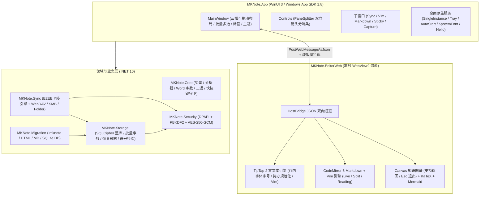

# MKNote Next 技术架构与开发规范文档

> **版本**：v1.0.0  
> **技术栈**：C# 14 / .NET 10 + WinUI 3 (Windows App SDK 1.8) + SQLCipher (AES-256) + WebView2 (TipTap 2 + CodeMirror 6 + KaTeX + Mermaid)  
> **产品定位**：100% 本地离线优先、全库加密落盘、双文档内核（富文本 + Markdown）、支持灵活三栏拖动布局、事务级批量管理与端到端加密（E2EE）群晖 NAS / WebDAV 同步的现代 Windows 桌面知识库。

---

## 目录

1. [系统架构总览](#1-系统架构总览)
2. [模块分层与职责边界](#2-模块分层与职责边界)
3. [本地加密存储与数据模型](#3-本地加密存储与数据模型)
4. [双内核编辑器与前后端桥接协议](#4-双内核编辑器与前后端桥接协议)
5. [端到端加密同步引擎设计](#5-端到端加密同步引擎设计)
6. [多格式迁移与待办复选框规范化](#6-多格式迁移与待办复选框规范化)
7. [安全性、防崩溃与桌面原生集成](#7-安全性防崩溃与桌面原生集成)
8. [国际化、灵活三栏布局与系统字体保护](#8-国际化灵活三栏布局与系统字体保护)
9. [构建、测试与打包发布规范](#9-构建测试与打包发布规范)

---

## 1. 系统架构总览

MKNote Next 采用 **原生 WinUI 3 桌面外壳 + 分层跨平台 .NET 10 核心类库 + 离线本地 WebView2 双内核编辑器** 的混合架构：



---

## 2. 模块分层与职责边界

| 项目 | 目标框架 | 职责边界 |
| :--- | :--- | :--- |
| `MKNote.Core` | `net10.0` | 领域实体模型（`NoteItem`、`CategoryItem`、`AppSettings`、`SyncSettings` 等）、仓储接口 `IVaultRepository`、Markdown 分析与 Word 风格字数统计 `MarkdownAnalyzer`、内置模板 `BuiltinTemplates`、三语词条 `Strings`、快捷键目录与保留热键守卫 `ShortcutGuard` |
| `MKNote.Security` | `net10.0` | `VaultKeyManager`（256 位主密钥生成、DPAPI / 便携密钥封装、逐 BLOB AES-256-GCM 加密）；`NoteCryptoService`（PBKDF2-SHA256 + AES-256-GCM 单篇笔记与 E2EE 同步加密、应用锁口令哈希与常量时间校验） |
| `MKNote.Storage` | `net10.0` | `SqliteVaultRepository`（基于 `SQLitePCLRaw.bundle_e_sqlcipher` 的整库加密仓储）、分类/标签/笔记/附件/双链/全局资源 CRUD、单事务批量删除/恢复、并行全库精准符号检索、防崩溃加密恢复日志、本地历史版本库 `revisions.db` 与 `.mkbackup` 备份 |
| `MKNote.Sync` | `net10.0` | `EncryptedSyncService`（增量双向同步、冲突副本保护、E2EE 密文打包）、`WebDavSyncTransport`（群晖 WebDAV 与通用 WebDAV）、`FolderSyncTransport`（SMB 共享与本地目录）、`SyncGuideProvider`（三语配置向导） |
| `MKNote.Migration` | `net10.0` | `MknotePackageReader`（`.SFDS`/MKEN/ZLIB `.mknote` 归档解析器）、`VaultMigrationService`（HTML 文件夹图文与待办复选框导入、Markdown 文件夹双向导入导出、本地 SQLite 数据库迁移） |
| `MKNote.EditorWeb` | Vite 6 + TS | 纯离线打包输出至 `src/MKNote.App/Assets/EditorWeb`，不依赖任何外网 CDN；封装富文本、Markdown、系统字体/字号工具条、待办复选框转换器、Vim 状态条、KaTeX、Mermaid、知识图谱与 Word 字数统计 |
| `MKNote.App` | `net10.0-windows10.0.19041.0` | WinUI 3 主程序、自定义 `PaneSplitter` 拖动分隔条、WebView2 虚拟域加密媒体拦截、区域截图、系统托盘、开机自启、安全系统字体服务与严格单实例守护 |
| `MKNote.Tests` | `net10.0` | 自包含 xUnit 单元测试套件，覆盖加密安全、仓储 CRUD、批量事务删除与恢复、符号检索、防崩溃恢复、E2EE 同步、多格式导入导出与待办复选框转换 |

---

## 3. 本地加密存储与数据模型

### 3.1 零明文磁盘策略
- **数据库级加密**：`vault.db` 与 `revisions.db` 均通过 SQLCipher 以 256 位十六进制主密钥打开，文件头部不包含 `SQLite format 3` 明文魔数。
- **对象级二次加密**：`notes.content_blob` 与 `media_blobs.cipher_blob` 均经 `VaultKeyManager.EncryptBlob` 按 `[4B "MKB1"][12B Nonce][16B AuthTag][Ciphertext]` 执行 AES-256-GCM 认证加密（AAD 绑定 `"MKB1"`）。
- **主密钥保护（`vault.key`）**：
  - 标准模式：`MKVK` 魔数头 + Windows `ProtectedData.Protect(..., DataProtectionScope.CurrentUser)`。
  - 便携模式（程序同级存在 `Data/` 目录或 `portable.flag` 时自动激活）：`MKVP` 魔数头 + 便携信封密钥封装。
- **附件去重与垃圾回收**：截图、插入图片与导入媒体按内容 `SHA-256` 去重存入 `media_blobs`；全局文档背景图登记于 `global_assets` 表，免受普通笔记附件垃圾回收误删。

### 3.2 核心数据表与批量事务能力（`SchemaSql.cs` / `SqliteVaultRepository.cs`）
- `categories`：多级笔记本目录树，支持默认与自定义目录自由删除（初始化标记写入 `settings`，删除默认目录后重启不重建）。
- `notes`：笔记元数据、加密正文 `content_blob`、摘要、格式标记、背景配置、置顶/星标/加密/便签/软删除标记。
- `tags` & `note_tags`：多对多标签关联，富文本与 Markdown 统一支持。
- `media_blobs` & `attachments` & `global_assets`：加密媒体内容池与引用表。
- `note_links`：Markdown 双向链接与嵌入关系表，驱动反向链接与知识图谱。
- `notes_fts`：SQLite FTS5 trigram 虚拟表，结合全库解密内存缓存并行扫描支持 `C#`、`->`、`[[双链]]`、`$100` 等任意符号精准检索。
- **事务级批处理 API**：`SoftDeleteNotesBatchAsync`、`RestoreNotesBatchAsync`、`PermanentlyDeleteNotesBatchAsync` 在单个 SQLite 事务内完成数百篇文档状态更新与索引清理，并在永久删除末尾统一执行一次孤立媒体垃圾回收。

---

## 4. 双内核编辑器与前后端桥接协议

### 4.1 离线虚拟主机与媒体安全拦截
- WebView2 将 `https://appassets.mknote.local/` 映射到程序本地离线目录 `Assets/EditorWeb/`。
- 所有图片与附件统一使用受控虚拟地址 `https://vault.mknote.local/attachments/{sha256}`。
- `MainWindow.OnWebResourceRequested` 拦截请求，实时在内存中解密对应 `SHA-256` 密文流返回给 WebView2，同时屏蔽外部非本地域 HTTP/HTTPS 请求，保障 100% 离线安全。

### 4.2 JSON 消息协议（`HostBridge`）
- **宿主 → 编辑器**：`editor.loadDocument`、`editor.clear`、`editor.setLocale`、`editor.setSystemFonts`、`editor.setBackground`、`editor.setBackgroundImage`、`editor.setVimConfig`、`editor.setMarkdownShortcuts`、`editor.setViewMode`、`editor.execCommand`、`editor.insertMedia`、`editor.scrollToHeading`、`editor.updateKnownTitles`、`graph.loadData`。
- **编辑器 → 宿主**：`editor.ready`、`editor.fontSettingsChanged`、`doc.contentChanged`、`doc.statsChanged`、`doc.forceSaveRequested`、`doc.openWikiLink`、`doc.savePastedAsset`、`doc.pickImageRequested`、`doc.captureScreenRequested`、`vim.modeChanged`、`graph.openNote`、`graph.close`。

### 4.3 工具栏、行内字体与图谱回退
- **系统字体与字号联动**：宿主启动时将过滤后的本机系统字体列表推送至前端，Markdown 与富文本工具栏均可直接切换字体与字号（12px–32px）。富文本通过扩展 TipTap `ExtendedTextStyle` 支持选区局部字体/字号混排，无选区时则更新默认正文字体并回传宿主持久化。
- **知识图谱回退**：图谱顶部提供「← 返回文档」按钮，配合前端与宿主双侧 `Esc` 监听及再次点击「知识图谱」切换关闭，随时无损返回编辑视图。

---

## 5. 端到端加密同步引擎设计

### 5.1 远端目录结构
```text
<SyncRoot>/
├── manifest.json          # 远端同步清单（记录笔记/分类/媒体版本与更新时间）
├── notes/{noteId}.mke     # 单篇笔记快照（E2EE 开启时为 AES-256-GCM 密文 JSON）
└── blobs/{sha256}.mkb     # 去重图片与附件数据块（E2EE 开启时为 AES-256-GCM 密文）
```

### 5.2 增量同步与零覆盖冲突策略
1. 使用 E2EE 同步口令经 PBKDF2-SHA256（120,000 次迭代 + 随机盐）派生密钥对每个对象独立加密。
2. 对比本地与远端内容哈希及修改时间执行增量上传/下载；若双端并发修改同一笔记，自动在本地生成 `[同步冲突副本 ...]` 保留双方完整正文。
3. `WebDavSyncTransport` 支持 Basic 认证、`MKCOL`、`PROPFIND` 与可选局域网自签名证书信任；`FolderSyncTransport` 使用 `.tmp` 原子替换写入防止半截文件损坏。

---

## 6. 多格式迁移与待办复选框规范化

- **`.mknote` 归档解析（`MknotePackageReader`）**：解析 `.SFDS` 容器头、目录表与 `MKEN` + ZLIB 数据块，自动识别 UTF-16LE / UTF-8 / GB18030，还原分类、标签、正文与内嵌图片并重写图片引用为应用内加密 URL。
- **HTML 文件夹批量导入（`VaultMigrationService.ImportHtmlFolderAsync`）**：递归扫描 `.html`/`.htm`，提取标题、正文、相对路径本地图片与 Data URI 图片并全部加密入库。
- **双端待办复选框规范化**：
  - 导入阶段（`VaultMigrationService.NormalizeImportedHtmlTodos`）与编辑器载入/粘贴阶段（`RichTextEditorController.normalizeTodoHtml`）双重处理原生 `<input type="checkbox">`、`role="checkbox"`、`data-checked`、`-checked:true|false` 样式及 `<br>` 分隔多行待办，统一转为 TipTap 可点击交互的标准 `<ul data-type="taskList"><li data-type="taskItem" data-checked="true|false">` 结构，零散行内复选框兜底转为 `☑` / `☐`。
- **Markdown 文件夹双向导入导出**：保留多级目录为笔记本分类，支持双向批量迁移。

---

## 7. 安全性、防崩溃与桌面原生集成

- **防崩溃恢复**：`App.xaml.cs` 捕获 UI / AppDomain / Task 未处理异常写入 `%LOCALAPPDATA%\MKNoteNext\Logs\`；每次编辑先异步写入加密恢复文件 `recovery/{noteId}.mkr`，正式落盘后清除；异常重启后自动恢复所有未提交草稿。
- **严格单实例（`SingleInstanceGuard`）**：基于 `Local\MKNoteNext_StrictSingleInstance_Mutex_9F4E2A7C` 互斥量与命名管道唤醒通道，彻底禁止双开多开，重复启动自动唤起前台或托盘中已有窗口。
- **系统托盘与开机自启**：基于 Win32 `Shell_NotifyIconW` + `SetWindowSubclass` 实现零额外依赖托盘；开机自启写入当前用户注册表 `Run` 项并带 `--autostart` 静默驻留托盘。
- **纯内存区域截图（`ScreenCaptureService` + `ScreenCaptureWindow`）**：跨多显示器截取虚拟屏幕位图，高 DPI 裁剪后在内存中编码为 PNG 直接加密存入数据库。

---

## 8. 国际化、灵活三栏布局与系统字体保护

- **三语热切换（`Strings.cs`）**：完整支持 `zh-CN`、`en-US`、`ja-JP`，涵盖主界面、批量操作栏、知识图谱、系统托盘菜单与同步指南。
- **灵活三栏拖动布局（`PaneSplitter.cs`）**：
  - 继承自 `Grid` 的轻量分隔条控件，内置 `InputSystemCursorShape.SizeWestEast`（`↔`）光标与悬停高亮竖线，以父级容器为坐标系计算偏移消除拖拽抖动；
  - 支持左侧导航栏、中间笔记列表栏、右侧信息抽屉三栏独立拖动放缩，双击恢复默认宽度，并持久化保存至 `AppSettings`（`SidebarWidth`、`NoteListWidth`、`InspectorWidth`）。
- **系统字体与 WinUI 图标保护（`SystemFontService.cs` + `MainWindow.ApplyUiFont`）**：
  - 枚举系统字体时自动跳过 `@` 竖排字体、`SYMBOL_CHARSET` 及符号/图标类字体；
  - 界面与编辑器均自动附加多语言安全回退链；
  - 递归应用界面字体时严格跳过 `IconElement` 子树、内置图标字体控件及包含 Unicode 私用区图标字符（`U+E000–U+F8FF`）的元素，杜绝切换字体导致图标乱码。
- **固定快捷键守卫（`ShortcutGuard`）**：禁止自定义 Vim 或 Markdown 快捷键覆盖应用核心固定热键，同时校验重复冲突。

---

## 9. 构建、测试与打包发布规范

### 9.1 验证命令
```powershell
# 1. 前端类型检查与离线构建
cd src/MKNote.EditorWeb
npx tsc --noEmit
npm run build
cd ../..

# 2. 单元测试（要求 0 失败、0 警告）
dotnet test tests/MKNote.Tests/MKNote.Tests.csproj

# 3. 桌面应用构建 (x64)
dotnet build src/MKNote.App/MKNote.App.csproj -c Debug -p:Platform=x64
```

### 9.2 正式安装包打包与仓库规范
1. 执行 `dotnet publish src/MKNote.App/MKNote.App.csproj -c Release -r win-x64 --self-contained true -p:Platform=x64 -o dist/publish-x64`。
2. 执行 `iscc installer/MKNoteNext.iss` 生成安装包 `dist/MKNoteNext_Setup_v1.0.0_x64.exe`，随后清理中间解包目录 `dist/publish-x64`。
3. `.gitignore` 严格排除 `bin/`、`obj/`、`dist/`、`node_modules/`、`src/MKNote.App/Assets/EditorWeb/`、用户数据与测试归档及所有可执行/安装包文件，确保 Git 仓库仅包含纯净可复现的源码、测试与文档。
